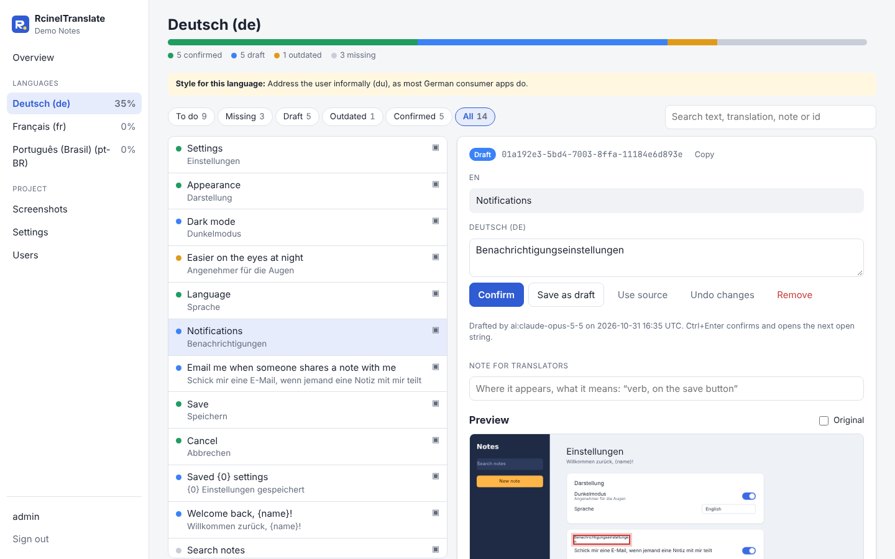
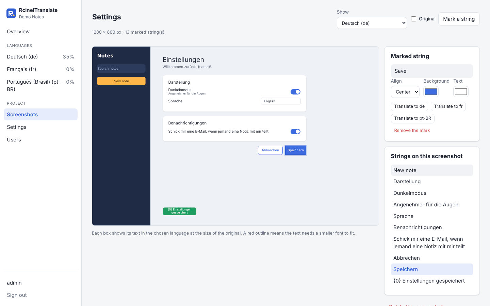

# RcinelTranslate

Translations for apps, keyed by UUIDv7. Write the English text where it's used:

```csharp
saveButton.Text = Translate("01a192e3-5bd4-7005-b3d0-b98f0a9cfe3d", "Save");   // C#
```

```js
saveButton.textContent = translate("01a192e3-5bd4-7005-b3d0-b98f0a9cfe3d", "Save");   // Java, JavaScript, Python, Rust
```

With German loaded the app shows "Speichern"; without a translation it shows "Save".

- **Clients** for .NET (netstandard2.0), Java 8+ and Android, JavaScript, Python 3.9+ and Rust 1.70+.
  No dependencies.
- **Plain JSON files**, one per language, sorted by id. A UUIDv7 starts with its creation time, so new
  strings land at the end and diffs stay small.
- **`rtr`**: collects the calls from your code, assigns ids, shows progress, checks files in CI.
- **A web editor**: AI drafts the missing translations, people confirm or correct them, and
  screenshots show each text in place with a live preview.

| | |
|---|---|
|  |  |

## How it works

```
your app
├── src/                  Translate("id", "English text") calls
└── i18n/
    ├── rcinel-translate.json   languages, code folders, AI settings
    ├── translations/     ← ship this: en.json (generated), de.json, fr.json, ...
    ├── review/           who confirmed what
    └── context/          notes and screenshots for translators
```

1. Write `Translate("", "English text")` in the code (lowercase `translate` outside C#).
2. `rtr scan --assign` fills in the ids and writes the English texts to `translations/en.json`.
3. In the editor, draft each language with AI, then confirm or correct the drafts.
4. Commit `i18n/` with the code.
5. In CI, `rtr check` catches broken placeholders and malformed files; `--require-confirmed` blocks
   a release until everything is reviewed.

The file format: [docs/format.md](docs/format.md).

## Clients

All five load a language with its fallback chain (`de-AT` reads `de.json`, then `de-AT.json` on top)
and show the English text for ids without a translation. They share one set of test cases
([spec/fixtures](spec/fixtures)).

| Language | Install | Use |
|---|---|---|
| .NET | `dotnet add package Rcinel.Translate` | `TryLoad(CultureInfo.CurrentUICulture.Name);`<br>`Translate(id, "Saved {0} settings", count)` |
| Java, Kotlin | `io.github.codeisnotevil:rcinel-translate:0.1.0` | `import static io.github.codeisnotevil.rcinel.Rcinel.translate;`<br>`translate(id, "Saved {0} settings", count)` |
| JavaScript | `npm install rcinel-translate` | `import { translate, tryLoad } from 'rcinel-translate';`<br>`translate(id, 'Welcome back, {name}!', { name })` |
| Python | `pip install rcinel-translate` | `from rcinel_translate import translate, try_load`<br>`translate(id, "Welcome back, {name}!", name=name)` |
| Rust | `rcinel-translate = "0.1"` | `use rcinel_translate::{translate, translate_with, try_load};`<br>`translate_with(id, "Saved {0} settings", &[("0", &count)])` |

Where each client looks for `translations/<language>.json` by default:

- .NET and Rust: next to the app. Python: `./translations`. Java: the class path (`src/main/resources`).
  JavaScript: fetched from `baseUrl`, or from disk with `rcinel-translate/node`.
- Every client can also take a set you read yourself (embedded resources, Android assets, bundled
  JSON, package data, `include_str!`) and switch to it with `Use` / `use` / `use_set`.

**.NET:** on .NET 6+ the package adds `global using static Rcinel.Translate.Rcinel;`, so `Translate`
works in every file. On older targets, write that `using static` per file. To turn the global using
off, set `<RcinelTranslateGlobalUsing>false</RcinelTranslateGlobalUsing>`. To ship the files:

```xml
<None Include="..\i18n\translations\*.json" LinkBase="translations" CopyToOutputDirectory="PreserveNewest" />
```

API details: [JavaScript](javascript/README.md), [Python](python/README.md), [Rust](rust/README.md).

## The `rtr` command

```
dotnet tool install -g Rcinel.Translate.Cli
```

| Command | Does |
|---|---|
| `rtr init i18n --languages de,fr --sources ../src` | Creates a project. |
| `rtr scan [--assign]` | Collects the calls into `en.json`; `--assign` writes new ids into empty `""` ids. |
| `rtr status [--json]` | Progress per language. |
| `rtr check [--require-complete \| --require-confirmed] [--strict]` | Validates placeholders, ids and canonical form. Exits 1 on errors. |
| `rtr format` | Rewrites the files in canonical form. |
| `rtr prune` | Removes translations of strings no longer in the code. |
| `rtr add-language pt-BR --name "Português"` | Adds a language. |
| `rtr export build/translations [--confirmed-only]` | Writes the files to ship. |
| `rtr draft de` | AI-drafts a language (needs `ANTHROPIC_API_KEY`). |
| `rtr id [count]` | Prints new UUIDv7s. |

`rtr` finds the project from any folder inside your app. The scanner reads calls whose id and text
are string literals, and reports the ones it can't read. Add your own wrapper functions under
`functions` in `rcinel-translate.json`.

```
$ rtr status
Demo Notes: 14 strings in en
Language  Confirmed       Draft  Outdated  Missing
de        ###----...  35%      5         1        3
fr        -.........   0%      2         0       12
```

## The editor

It works on the `i18n` folder of a checkout, so its changes are ordinary file changes you commit.

- **Overview**: progress per language, `rtr check` results, adding languages.
- **Language view**: every string with its state, filters and search. Ctrl+Enter confirms and moves
  on.
- **AI drafts**: one click drafts a whole language, using screenshots, notes, style rules and
  confirmed terms. Drafts stay drafts until a person confirms them.
- **Screenshots**: mark each text with a box and preview any language in place. Text that doesn't
  fit is outlined in red.
- **Users**: admins and translators, no self-registration.

```fish
cp .env.example .env    # set RCINEL_PROJECT and an admin password
podman compose up -d --build    # http://localhost:8080
```

Or from source:

```fish
cd dotnet
set -x Rcinel__Project ../samples/demo/i18n
set -x Rcinel__AdminUser admin
set -x Rcinel__AdminPassword a-long-password
set -x ANTHROPIC_API_KEY sk-ant-...   # optional, for AI drafts
dotnet run --project src/Editor       # http://localhost:5280
```

`.env.example` covers the setup link for the first account and running under Docker. Put the editor
behind HTTPS if it's reachable from outside.

## Try it

[`samples/demo`](samples/demo) is a small app with a German, French and Portuguese project at various
stages. Point the editor at `samples/demo/i18n`.

## Building

| Part | Folder | Build and test |
|---|---|---|
| .NET client, core, CLI, editor | `dotnet/` | `dotnet test RcinelTranslate.slnx` (.NET 10 SDK) |
| Java client | `java/` | `./gradlew test` (JDK 17+) |
| JavaScript client | `javascript/` | `npm test` (Node 18+) |
| Python client | `python/` | `PYTHONPATH=src python -m unittest discover -s tests -t .` |
| Rust client | `rust/` | `cargo test` |

All parts share one version, set in `dotnet/Directory.Build.props`, `java/gradle.properties`,
`javascript/package.json`, `python/pyproject.toml` and `rust/Cargo.toml`. CI checks that they match.

## Releasing

Set the version in all five files, add a dated `## X.Y.Z - yyyy-mm-dd` section to
[CHANGELOG.md](CHANGELOG.md), merge, then push a `vX.Y.Z` tag. The
[Release workflow](.github/workflows/release.yml) runs CI and publishes to every registry plus a
GitHub release. Re-running it after a partial failure is safe. It needs these repository secrets:

| Registry | Secrets |
|---|---|
| NuGet | `NUGET_USER` (your nuget.org profile name). Publishing is trusted: add a policy under your nuget.org account, **Trusted Publishing**, for owner `CodeIsNotEvil`, repository `RcinelTranslate`, workflow `release.yml`. |
| Maven Central | `MAVEN_CENTRAL_USERNAME`, `MAVEN_CENTRAL_PASSWORD` (a user token from central.sonatype.com, with the `io.github.codeisnotevil` namespace verified), `MAVEN_SIGNING_KEY` (an ASCII-armored GPG private key), `MAVEN_SIGNING_PASSWORD` |
| npm | `NPM_TOKEN` |
| PyPI | `PYPI_API_TOKEN` |
| crates.io | `CARGO_REGISTRY_TOKEN` (publish scope) |

## License

MIT, see [LICENSE](LICENSE). The clients have no dependencies. The editor and CLI use the
[Anthropic C# SDK](https://github.com/anthropics/anthropic-sdk-csharp) (MIT). Build and test tools,
which don't ship with any client:
[Gradle Maven Publish Plugin](https://github.com/vanniktech/gradle-maven-publish-plugin) (Apache 2.0),
[Gson](https://github.com/google/gson) (Apache 2.0) and
[serde_json](https://github.com/serde-rs/json) (MIT or Apache 2.0).
